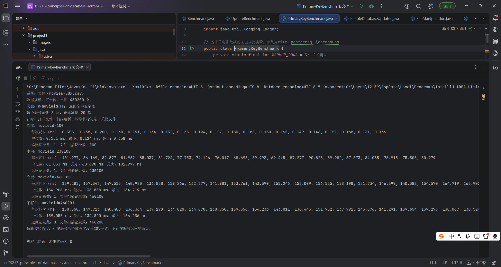
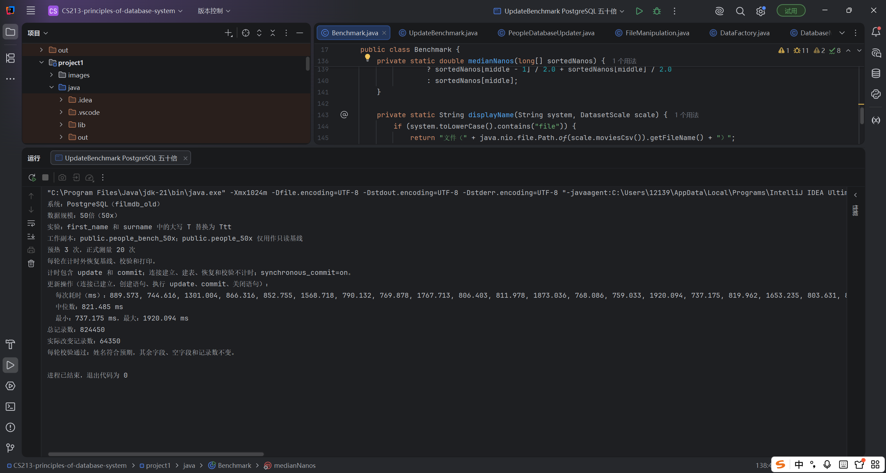
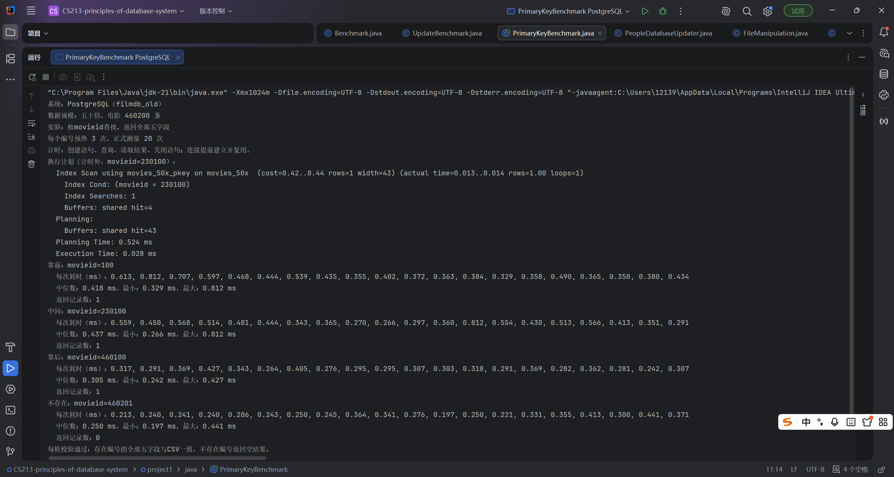
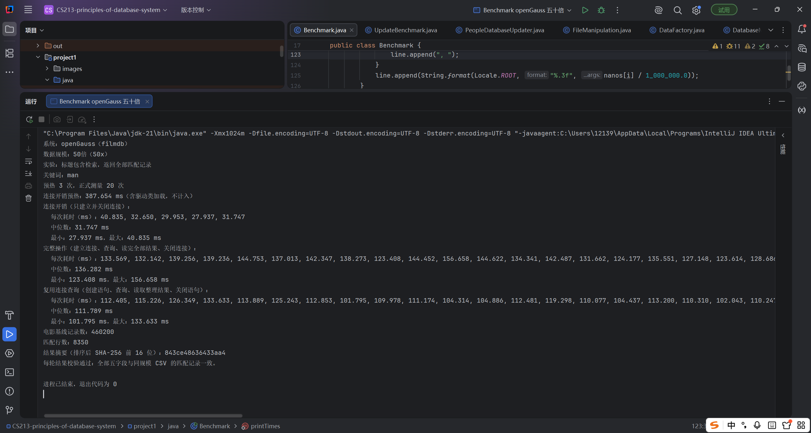
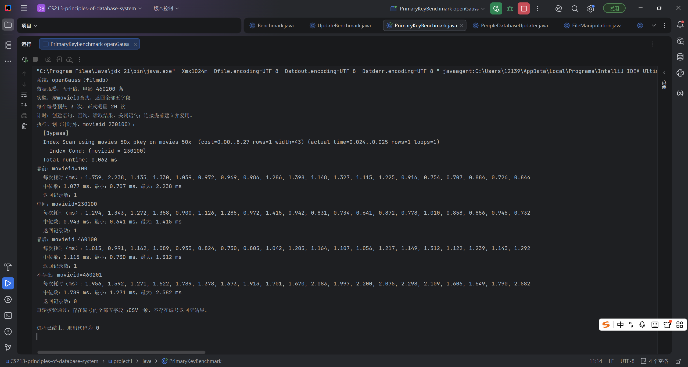

# Project 1：文件与数据库的性能比较

**张卓霖**

## 1. 实验设计与实现

在 Windows 上用 Java 21.0.8 比较 CSV 文件、PostgreSQL 18.6（原生服务）和 openGauss 6.0.6（Docker）。主要比较两项操作：1.检索标题中含小写 man 的电影，返回全部五字段；2.把 first_name、surname 中的全部大写 T 替换为 Ttt。

数据来自 lab1，设**原规模、十倍、五十倍**三组。电影分别有 **9,204、92,040、460,200** 条，人物分别有 **16,489、164,890、824,450** 条。扩充时重新分配唯一编号，并给名称追加随机的片段与编号，减少名称重复。三种实现使用同一批记录。

文件版直接读写CSV；数据库版通过JDBC连接PostgreSQL或openGauss，再执行查询和更新。

每组预热 3 次、正式测量 20 次，用 System.nanoTime 计时，取中间两项平均值作为中位数。原规模、十倍和五十倍分别匹配 167、1,670、8,350 条电影，改变 1,287、12,870、64,350 条人物。三种方式的结果一致，其余字段和空值保持不变。

## 2. 标题检索计时

文件完整操作包含打开、读取、解析、匹配、整理结果和关闭。数据库完整操作包含建立连接、查询、读取全部结果和关闭；复用连接列不计连接建立与关闭。表中均为中位数，单位 ms。

| 规模   | 文件完整 | PostgreSQL完整 | openGauss完整 | PostgreSQL复用 | openGauss复用 |
| ------ | -------: | -------------: | ------------: | -------------: | ------------: |
| 原规模 |    4.436 |        111.300 |        33.498 |          1.746 |         2.963 |
| 十倍   |   52.911 |        104.085 |        50.647 |         11.562 |        24.917 |
| 五十倍 |  172.816 |        151.077 |       136.282 |         62.611 |       111.789 |

原规模时，文件完整检索比每次重连的数据库操作快。**复用连接后，两个数据库的查询都比文件完整检索快，其中PostgreSQL更快**。计入连接后，三组实验中openGauss都比PostgreSQL快；到五十倍时，两种数据库的完整检索也都比文件快。

## 3. 姓名更新

文件计时包含完整读取、替换姓名、写入临时文件及替换工作文件。数据库连接提前建立，计时包含 update 和 commit，使用 synchronous_commit=on。表中均为中位数，单位 ms。

| 规模   |    文件 | PostgreSQL | openGauss |
| ------ | ------: | ---------: | --------: |
| 原规模 |  13.814 |     13.051 |    23.247 |
| 十倍   | 111.191 |    145.167 |   173.978 |
| 五十倍 | 600.899 |    821.485 |   895.367 |

原规模时 PostgreSQL 与文件耗时接近，扩充后文件更快。从十倍到五十倍，三种实现的更新耗时都约增至原来的五倍。文件需要完整读写全部记录；数据库只修改符合条件的记录，但筛选与提交也有成本。

文件写完后没有强制确认数据已经存到磁盘，突然断电时可能丢失修改。数据库则把同步提交的时间也算在内，所以这组耗时不能说明文件在相同的数据保存要求下更快。三组实验中PostgreSQL更新都比openGauss快，五十倍时两者更接近。

## 4. 主键查找（补充实验）

使用已有五十倍电影数据，查询靠前、中间、靠后和不存在的编号。文件从头逐行查找，找到后停止；数据库按movieid查询，并复用连接。每个编号预热3次、测量20次，核对全部五字段，执行计划在计时外查看。表中为中位数，单位ms。

| 查询位置 | movieid | 文件扫描 | PostgreSQL复用 | openGauss复用 |
|---|---:|---:|---:|---:|
| 靠前 | 100 | 0.151 | 0.418 | 1.077 |
| 中间 | 230100 | 81.853 | 0.437 | 0.943 |
| 靠后 | 460100 | 154.908 | 0.305 | 1.115 |
| 不存在 | 460201 | 139.053 | 0.250 | 1.789 |

文件只扫描100条记录时，比两个数据库都快；查找中间、靠后或不存在的编号时，需要扫描更多记录，比数据库慢得多。对编号230100，两个数据库的执行计划都显示Index Scan，使用主键索引定位记录。这展示了索引在大量数据中查找少量目标记录的作用。

## 5. 结论与比较标准

本实验中，数据库用SQL筛选和批量替换，并在主键查找中使用索引；文件程序需自行解析、扫描和改写数据。DBMS还能检查数据是否符合约束、在操作失败时回滚修改，并管理同时进行的读写。这些也是选择数据库的理由，不能只看一次操作的耗时。

比较PostgreSQL与openGauss，应使用相同的数据、执行相同的操作，并核对结果，再比较检索、更新和建立连接的耗时，以及多次运行的波动。本机这三种规模中，PostgreSQL的复用连接检索和更新更快，openGauss的含连接完整检索更快。PostgreSQL直接在Windows上运行，openGauss在Docker里运行，运行环境也可能影响耗时，所以这个结果只代表本机表现。

扩充后，记录更多，每条记录里的标题和姓名也更长。五十倍实验还用了不同的Java内存设置，所以耗时变化不能只用记录数增加来解释。

## 附录：五十倍运行结果

以下截图保留五十倍数据下三项实验、三种方式的运行结果。

### 文件

### PostgreSQL

### openGauss

